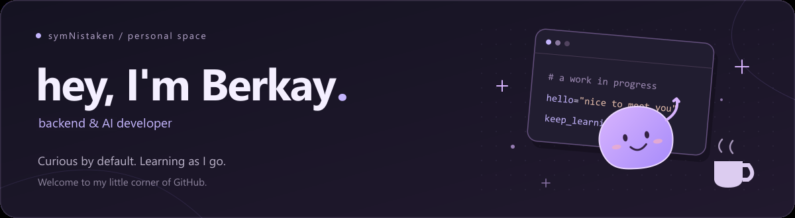
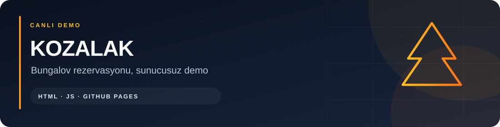
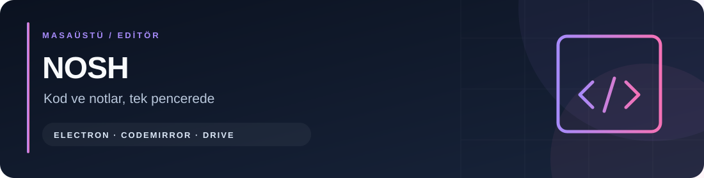

  

I'm **Berkay**, a developer interested in **backend development, AI, and data**. I learn by building: web and desktop apps, API integrations, and small AI experiments that turn into useful tools. Happy to talk about technology or something you're building.

### Selected projects

<table>
  <tr>
    <td width="50%" valign="top">
      
      
AI-powered game recommendations and player-profile analysis using Steam data.

      
Python · Flask · Groq · Steam Web API

      <a href="https://github.com/symNistaken/steam-agentai">View repository →</a>
    </td>
    <td width="50%" valign="top">
      
      
My backend contributions to a booking system with admin approval, availability checks, and email notifications.

      
Python · Flask · SQLite · SMTP

      <a href="https://github.com/symNistaken/bungalow-reservation-system">View repository →</a>
    </td>
  </tr>
  <tr>
    <td width="50%" valign="top">
      
      
Serverless live demo and landing page for a bungalow reservation product.

      
HTML · JavaScript · GitHub Pages

      <a href="https://symnistaken.github.io/kozalak-demo/">Live demo →</a>
    </td>
    <td width="50%" valign="top">
      
      
Desktop code and note editor with syntax highlighting, Google Drive sync, and Spotify controls.

      
Electron · JavaScript · CodeMirror

      <a href="https://github.com/symNistaken/nosh-source">View repository →</a>
    </td>
  </tr>
</table>

### Tech stack

  

Also: WPF · REST APIs · embeddings and semantic search (RAG) · GitHub Actions

### Contact

  
  

