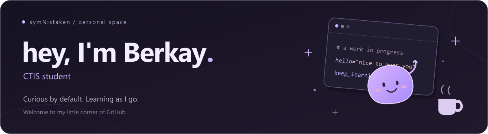

  

  

  

### Hello there, I'm Berkay — aka symNistaken 👋

I'm **Berkay**, interested in **backend development, AI, and data**. I like understanding how things work, experimenting with new ideas, and learning by building.

- 🧠 Exploring how AI can become part of useful everyday applications.
- 🛠️ Working with Python, C#, web technologies, and API integrations.
- 🌱 Learning through small experiments, challenges, and projects.
- 💬 Happy to connect and talk about technology or something you're building.

### Tech stack

<h4>Languages</h4>

   
  Python · C# · JavaScript · HTML · CSS

<h4>Frameworks &amp; Libraries</h4>

   
  Flask · .NET · OpenCV

WPF desktop applications

<h4>AI &amp; Data</h4>

   
  NumPy · pandas · TensorFlow · scikit-learn · Hugging Face · Groq · SQLite

SentenceTransformers · embeddings · semantic search · RAG

<h4>Tools</h4>

   
  Git · GitHub · GitHub Actions · Visual Studio · VS Code

---
### Areas I work in

<table>
  <tr>
    <td width="33%" valign="top">
      <h4>⚙️ Backend & desktop</h4>
      
Web and desktop applications, REST APIs, and database-backed workflows.

      
Python · Flask · C# · .NET · WPF · SQLite

    </td>
    <td width="33%" valign="top">
      <h4>🧠 AI & data</h4>
      
AI service integration, recommendations, embeddings, and semantic retrieval.

      
Groq · SentenceTransformers · NumPy

    </td>
    <td width="33%" valign="top">
      <h4>🔗 Integrations</h4>
      
Connecting applications to external APIs and email services.

      
Steam Web API · REST · SMTP

    </td>
  </tr>
</table>

---

### Selected projects

<table>
  <tr>
    <td width="50%" valign="top">
      
      
AI-powered game recommendations and player-profile analysis using Steam data.

      
Python · Flask · Groq · Steam Web API

      <a href="https://github.com/symNistaken/steam-agentai">View repository →</a>
    </td>
    <td width="50%" valign="top">
      
      
My backend contributions to a booking system with admin approval, availability checks, and email notifications.

      
Python · Flask · SQLite · SMTP

      <a href="https://github.com/symNistaken/bungalow-reservation-system">View repository →</a>
    </td>
  </tr>
</table>

---

  <h3>Let's connect</h3>
  
Have an idea, a question, or something you're building? I'd be happy to hear from you.

  

    
    &nbsp;
    
  

  
<a href="mailto:berkayseyman@gmail.com">berkayseyman@gmail.com</a>

  
Thanks for stopping by.

  

